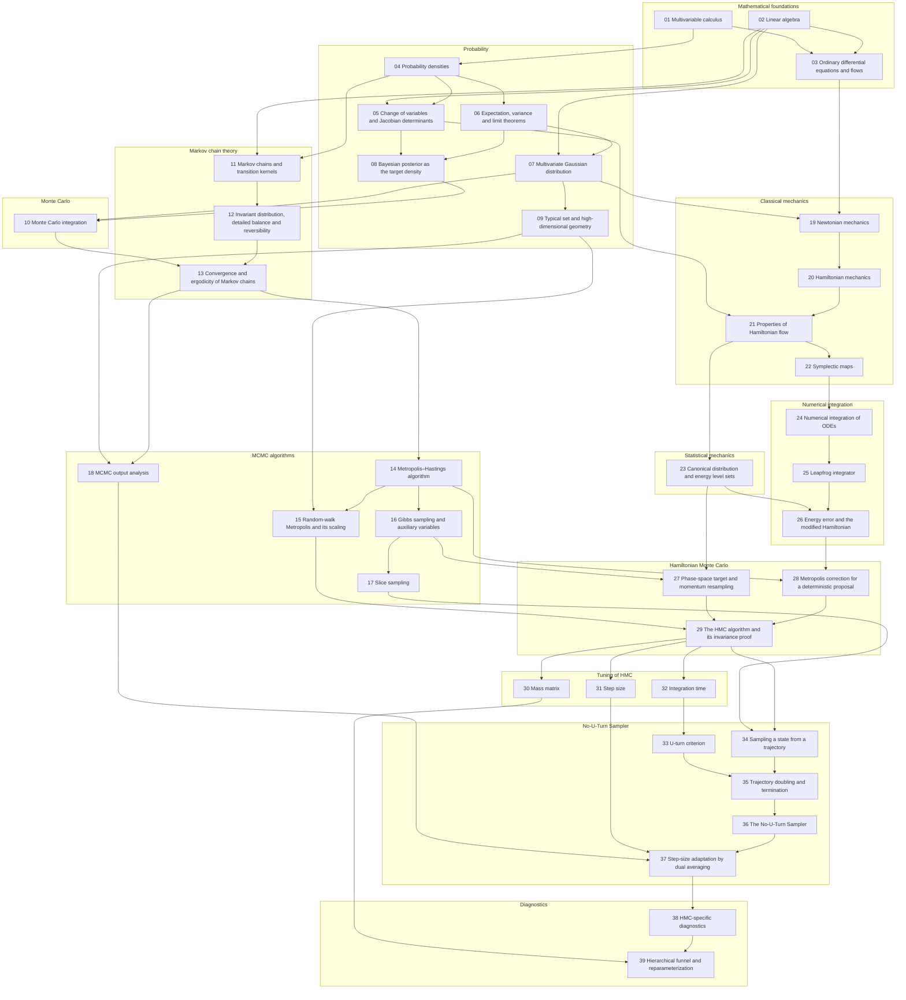

# Building blocks for MCMC, HMC and NUTS: index and dependency map

This folder contains 39 notes. Each note describes one building block of the knowledge required to understand Markov chain Monte Carlo (MCMC), Hamiltonian Monte Carlo (HMC) and the No-U-Turn Sampler (NUTS). The notes are numbered so that every block depends only on blocks with lower numbers; reading the notes in numerical order therefore satisfies every dependency.

## Dependency map

An arrow points from a prerequisite block to a block that depends on it. The diagram omits every dependency that is implied by a chain of other dependencies; each note lists its direct dependencies in full.

## Blocks by layer

| Block | Layer | Direct dependencies |
|---|---|---|
| [01. Multivariable calculus: gradient, chain rule, Taylor expansion](01-multivariable-calculus.md) | Mathematical foundations | none |
| [02. Linear algebra: positive-definite matrices, eigenvalues, determinants](02-linear-algebra.md) | Mathematical foundations | none |
| [03. Ordinary differential equations and flows](03-ordinary-differential-equations-and-flows.md) | Mathematical foundations | [01](01-multivariable-calculus.md), [02](02-linear-algebra.md) |
| [04. Probability densities: joint, marginal, conditional, unnormalized](04-probability-densities.md) | Probability | [01](01-multivariable-calculus.md) |
| [05. Change of variables and Jacobian determinants](05-change-of-variables-and-jacobians.md) | Probability | [01](01-multivariable-calculus.md), [02](02-linear-algebra.md), [04](04-probability-densities.md) |
| [06. Expectation, variance and limit theorems](06-expectation-and-limit-theorems.md) | Probability | [04](04-probability-densities.md) |
| [07. Multivariate Gaussian distribution](07-multivariate-gaussian-distribution.md) | Probability | [02](02-linear-algebra.md), [04](04-probability-densities.md), [06](06-expectation-and-limit-theorems.md) |
| [08. Bayesian posterior as the target density](08-bayesian-posterior-as-target.md) | Probability | [01](01-multivariable-calculus.md), [04](04-probability-densities.md), [05](05-change-of-variables-and-jacobians.md), [06](06-expectation-and-limit-theorems.md) |
| [09. Typical set and high-dimensional geometry](09-typical-set-and-high-dimensional-geometry.md) | Probability | [06](06-expectation-and-limit-theorems.md), [07](07-multivariate-gaussian-distribution.md) |
| [10. Monte Carlo integration](10-monte-carlo-integration.md) | Monte Carlo | [06](06-expectation-and-limit-theorems.md), [07](07-multivariate-gaussian-distribution.md), [08](08-bayesian-posterior-as-target.md) |
| [11. Markov chains and transition kernels](11-markov-chains-and-transition-kernels.md) | Markov chain theory | [02](02-linear-algebra.md), [04](04-probability-densities.md) |
| [12. Invariant distribution, detailed balance and reversibility](12-invariant-distribution-and-detailed-balance.md) | Markov chain theory | [02](02-linear-algebra.md), [11](11-markov-chains-and-transition-kernels.md) |
| [13. Convergence and ergodicity of Markov chains](13-convergence-and-ergodicity.md) | Markov chain theory | [06](06-expectation-and-limit-theorems.md), [10](10-monte-carlo-integration.md), [12](12-invariant-distribution-and-detailed-balance.md) |
| [14. Metropolis–Hastings algorithm](14-metropolis-hastings-algorithm.md) | MCMC algorithms | [08](08-bayesian-posterior-as-target.md), [12](12-invariant-distribution-and-detailed-balance.md), [13](13-convergence-and-ergodicity.md) |
| [15. Random-walk Metropolis and its scaling](15-random-walk-metropolis-and-its-scaling.md) | MCMC algorithms | [06](06-expectation-and-limit-theorems.md), [07](07-multivariate-gaussian-distribution.md), [09](09-typical-set-and-high-dimensional-geometry.md), [14](14-metropolis-hastings-algorithm.md) |
| [16. Gibbs sampling and auxiliary variables](16-gibbs-sampling-and-auxiliary-variables.md) | MCMC algorithms | [04](04-probability-densities.md), [07](07-multivariate-gaussian-distribution.md), [12](12-invariant-distribution-and-detailed-balance.md), [14](14-metropolis-hastings-algorithm.md) |
| [17. Slice sampling](17-slice-sampling.md) | MCMC algorithms | [16](16-gibbs-sampling-and-auxiliary-variables.md) |
| [18. MCMC output analysis: warm-up, R-hat, effective sample size](18-mcmc-diagnostics.md) | MCMC algorithms | [09](09-typical-set-and-high-dimensional-geometry.md), [10](10-monte-carlo-integration.md), [13](13-convergence-and-ergodicity.md) |
| [19. Newtonian mechanics](19-newtonian-mechanics.md) | Classical mechanics | [01](01-multivariable-calculus.md), [02](02-linear-algebra.md), [03](03-ordinary-differential-equations-and-flows.md), [07](07-multivariate-gaussian-distribution.md) |
| [20. Hamiltonian mechanics: phase space and Hamilton's equations](20-hamiltonian-mechanics.md) | Classical mechanics | [01](01-multivariable-calculus.md), [02](02-linear-algebra.md), [03](03-ordinary-differential-equations-and-flows.md), [19](19-newtonian-mechanics.md) |
| [21. Properties of Hamiltonian flow: energy conservation, reversibility, volume preservation](21-properties-of-hamiltonian-flow.md) | Classical mechanics | [01](01-multivariable-calculus.md), [02](02-linear-algebra.md), [03](03-ordinary-differential-equations-and-flows.md), [05](05-change-of-variables-and-jacobians.md), [20](20-hamiltonian-mechanics.md) |
| [22. Symplectic maps](22-symplectic-maps.md) | Classical mechanics | [02](02-linear-algebra.md), [20](20-hamiltonian-mechanics.md), [21](21-properties-of-hamiltonian-flow.md) |
| [23. Canonical distribution and energy level sets](23-canonical-distribution.md) | Statistical mechanics | [04](04-probability-densities.md), [07](07-multivariate-gaussian-distribution.md), [20](20-hamiltonian-mechanics.md), [21](21-properties-of-hamiltonian-flow.md) |
| [24. Numerical integration of ODEs: Euler's method, order, stability](24-numerical-integration-of-odes.md) | Numerical integration | [02](02-linear-algebra.md), [03](03-ordinary-differential-equations-and-flows.md), [05](05-change-of-variables-and-jacobians.md), [20](20-hamiltonian-mechanics.md), [21](21-properties-of-hamiltonian-flow.md), [22](22-symplectic-maps.md) |
| [25. Leapfrog (Störmer–Verlet) integrator](25-leapfrog-integrator.md) | Numerical integration | [05](05-change-of-variables-and-jacobians.md), [07](07-multivariate-gaussian-distribution.md), [21](21-properties-of-hamiltonian-flow.md), [22](22-symplectic-maps.md), [24](24-numerical-integration-of-odes.md) |
| [26. Energy error and the modified (shadow) Hamiltonian](26-energy-error-and-shadow-hamiltonian.md) | Numerical integration | [06](06-expectation-and-limit-theorems.md), [22](22-symplectic-maps.md), [23](23-canonical-distribution.md), [24](24-numerical-integration-of-odes.md), [25](25-leapfrog-integrator.md) |
| [27. Phase-space target and momentum resampling](27-phase-space-target-and-momentum-resampling.md) | Hamiltonian Monte Carlo | [07](07-multivariate-gaussian-distribution.md), [08](08-bayesian-posterior-as-target.md), [16](16-gibbs-sampling-and-auxiliary-variables.md), [23](23-canonical-distribution.md) |
| [28. Metropolis correction for a deterministic proposal](28-metropolis-correction-for-deterministic-proposals.md) | Hamiltonian Monte Carlo | [05](05-change-of-variables-and-jacobians.md), [14](14-metropolis-hastings-algorithm.md), [23](23-canonical-distribution.md), [25](25-leapfrog-integrator.md), [26](26-energy-error-and-shadow-hamiltonian.md) |
| [29. The HMC algorithm and its invariance proof](29-hmc-algorithm-and-invariance.md) | Hamiltonian Monte Carlo | [12](12-invariant-distribution-and-detailed-balance.md), [13](13-convergence-and-ergodicity.md), [15](15-random-walk-metropolis-and-its-scaling.md), [27](27-phase-space-target-and-momentum-resampling.md), [28](28-metropolis-correction-for-deterministic-proposals.md) |
| [30. Mass matrix (Euclidean metric)](30-mass-matrix.md) | Tuning of HMC | [02](02-linear-algebra.md), [05](05-change-of-variables-and-jacobians.md), [07](07-multivariate-gaussian-distribution.md), [29](29-hmc-algorithm-and-invariance.md) |
| [31. Step size: stability, scaling with dimension, optimal acceptance rate](31-step-size-tuning.md) | Tuning of HMC | [15](15-random-walk-metropolis-and-its-scaling.md), [25](25-leapfrog-integrator.md), [26](26-energy-error-and-shadow-hamiltonian.md), [29](29-hmc-algorithm-and-invariance.md) |
| [32. Integration time (trajectory length)](32-integration-time.md) | Tuning of HMC | [15](15-random-walk-metropolis-and-its-scaling.md), [23](23-canonical-distribution.md), [29](29-hmc-algorithm-and-invariance.md) |
| [33. U-turn criterion](33-u-turn-criterion.md) | No-U-Turn Sampler | [01](01-multivariable-calculus.md), [02](02-linear-algebra.md), [32](32-integration-time.md) |
| [34. Sampling a state from a trajectory](34-sampling-a-state-from-a-trajectory.md) | No-U-Turn Sampler | [04](04-probability-densities.md), [12](12-invariant-distribution-and-detailed-balance.md), [17](17-slice-sampling.md), [29](29-hmc-algorithm-and-invariance.md) |
| [35. Trajectory doubling and termination](35-trajectory-doubling-and-termination.md) | No-U-Turn Sampler | [33](33-u-turn-criterion.md), [34](34-sampling-a-state-from-a-trajectory.md) |
| [36. The No-U-Turn Sampler (NUTS)](36-nuts-algorithm.md) | No-U-Turn Sampler | [16](16-gibbs-sampling-and-auxiliary-variables.md), [29](29-hmc-algorithm-and-invariance.md), [33](33-u-turn-criterion.md), [34](34-sampling-a-state-from-a-trajectory.md), [35](35-trajectory-doubling-and-termination.md) |
| [37. Step-size adaptation by dual averaging](37-step-size-adaptation-by-dual-averaging.md) | No-U-Turn Sampler | [18](18-mcmc-diagnostics.md), [31](31-step-size-tuning.md), [36](36-nuts-algorithm.md) |
| [38. HMC-specific diagnostics: divergences, energy, tree depth](38-hmc-diagnostics.md) | Diagnostics | [18](18-mcmc-diagnostics.md), [23](23-canonical-distribution.md), [26](26-energy-error-and-shadow-hamiltonian.md), [36](36-nuts-algorithm.md), [37](37-step-size-adaptation-by-dual-averaging.md) |
| [39. Hierarchical funnel and reparameterization](39-hierarchical-funnel-and-reparameterization.md) | Diagnostics | [05](05-change-of-variables-and-jacobians.md), [08](08-bayesian-posterior-as-target.md), [25](25-leapfrog-integrator.md), [30](30-mass-matrix.md), [38](38-hmc-diagnostics.md) |

## Blocks required for three targets

Each list contains the target block and all blocks on which it depends, directly or through other blocks.

- **Metropolis–Hastings algorithm (general MCMC)**, block [14](14-metropolis-hastings-algorithm.md): 12 blocks: [01](01-multivariable-calculus.md), [02](02-linear-algebra.md), [04](04-probability-densities.md), [05](05-change-of-variables-and-jacobians.md), [06](06-expectation-and-limit-theorems.md), [07](07-multivariate-gaussian-distribution.md), [08](08-bayesian-posterior-as-target.md), [10](10-monte-carlo-integration.md), [11](11-markov-chains-and-transition-kernels.md), [12](12-invariant-distribution-and-detailed-balance.md), [13](13-convergence-and-ergodicity.md), [14](14-metropolis-hastings-algorithm.md).
- **HMC algorithm with a fixed number of leapfrog steps**, block [29](29-hmc-algorithm-and-invariance.md): 27 blocks: [01](01-multivariable-calculus.md), [02](02-linear-algebra.md), [03](03-ordinary-differential-equations-and-flows.md), [04](04-probability-densities.md), [05](05-change-of-variables-and-jacobians.md), [06](06-expectation-and-limit-theorems.md), [07](07-multivariate-gaussian-distribution.md), [08](08-bayesian-posterior-as-target.md), [09](09-typical-set-and-high-dimensional-geometry.md), [10](10-monte-carlo-integration.md), [11](11-markov-chains-and-transition-kernels.md), [12](12-invariant-distribution-and-detailed-balance.md), [13](13-convergence-and-ergodicity.md), [14](14-metropolis-hastings-algorithm.md), [15](15-random-walk-metropolis-and-its-scaling.md), [16](16-gibbs-sampling-and-auxiliary-variables.md), [19](19-newtonian-mechanics.md), [20](20-hamiltonian-mechanics.md), [21](21-properties-of-hamiltonian-flow.md), [22](22-symplectic-maps.md), [23](23-canonical-distribution.md), [24](24-numerical-integration-of-odes.md), [25](25-leapfrog-integrator.md), [26](26-energy-error-and-shadow-hamiltonian.md), [27](27-phase-space-target-and-momentum-resampling.md), [28](28-metropolis-correction-for-deterministic-proposals.md), [29](29-hmc-algorithm-and-invariance.md).
- **No-U-Turn Sampler**, block [36](36-nuts-algorithm.md): 33 blocks: [01](01-multivariable-calculus.md), [02](02-linear-algebra.md), [03](03-ordinary-differential-equations-and-flows.md), [04](04-probability-densities.md), [05](05-change-of-variables-and-jacobians.md), [06](06-expectation-and-limit-theorems.md), [07](07-multivariate-gaussian-distribution.md), [08](08-bayesian-posterior-as-target.md), [09](09-typical-set-and-high-dimensional-geometry.md), [10](10-monte-carlo-integration.md), [11](11-markov-chains-and-transition-kernels.md), [12](12-invariant-distribution-and-detailed-balance.md), [13](13-convergence-and-ergodicity.md), [14](14-metropolis-hastings-algorithm.md), [15](15-random-walk-metropolis-and-its-scaling.md), [16](16-gibbs-sampling-and-auxiliary-variables.md), [17](17-slice-sampling.md), [19](19-newtonian-mechanics.md), [20](20-hamiltonian-mechanics.md), [21](21-properties-of-hamiltonian-flow.md), [22](22-symplectic-maps.md), [23](23-canonical-distribution.md), [24](24-numerical-integration-of-odes.md), [25](25-leapfrog-integrator.md), [26](26-energy-error-and-shadow-hamiltonian.md), [27](27-phase-space-target-and-momentum-resampling.md), [28](28-metropolis-correction-for-deterministic-proposals.md), [29](29-hmc-algorithm-and-invariance.md), [32](32-integration-time.md), [33](33-u-turn-criterion.md), [34](34-sampling-a-state-from-a-trajectory.md), [35](35-trajectory-doubling-and-termination.md), [36](36-nuts-algorithm.md).
- **Blocks outside the NUTS list**: [18](18-mcmc-diagnostics.md), [30](30-mass-matrix.md), [31](31-step-size-tuning.md), [37](37-step-size-adaptation-by-dual-averaging.md), [38](38-hmc-diagnostics.md), [39](39-hierarchical-funnel-and-reparameterization.md). These blocks cover output analysis, tuning and diagnostics.
